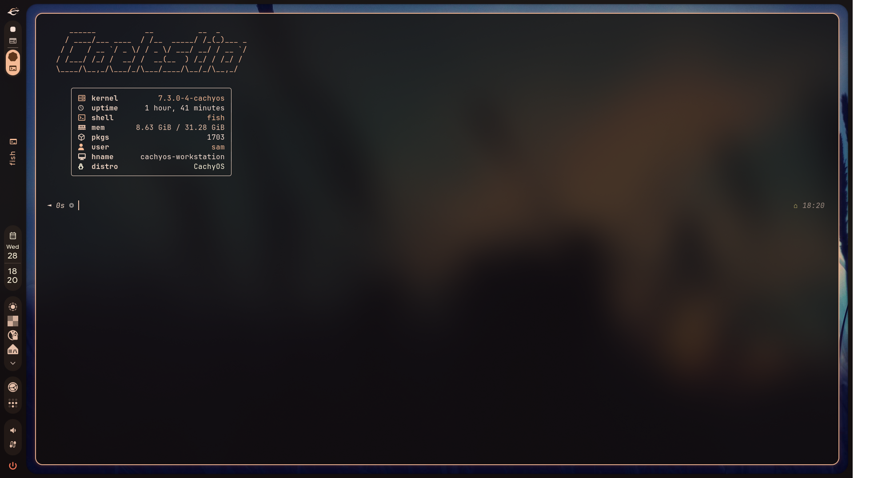
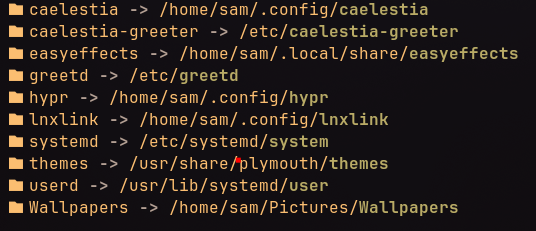

# Moddroid dot-files & Scripts

## Stack Base:
- CachyOS
- Hyprland 0.56+

## User Apps (not included):
- plymouth-theme-cross-hud-git
- hyprmod
- caelestia-dots
- caelestia-greeter
- caelestia-syncthing
- caelestia-tailscale
- lnxlink
- Easyeffects AppImage
- Music Assistant AppImage
- Vesktop AppImage
- Keepassxc
- tailscaled
- syncthing
- localsend
- lindiskinfo
- Butler
- hypr-lens
- vicinae-bin
- astra-atlas
- awww

## Scripts:
- dpms-guard (DP Monitor unplug hotifx)
- fix-ntfs (Fix nvme corruption on bad unmount)

## Services:
- lnxlink.service (delay lnxlink to allow hyprland startup)
- greetd (hide logs between plymouth and login)
- plymouth overrides (allow full boot splash animation)

## Presets:
- Easyeffects Presets

## Extras:
- Wallpapers Folder

# Setup Info:

- Custom greetd + caelestia-greeter login 
- Autostart Music & Home App on custom workspaces
- Autostart background apps
- Autostart fix scripts services & daemons
- custom plymouth animation and timers
- custom SUPER + ALT + F12 caelestia reload
# Screenshots:

