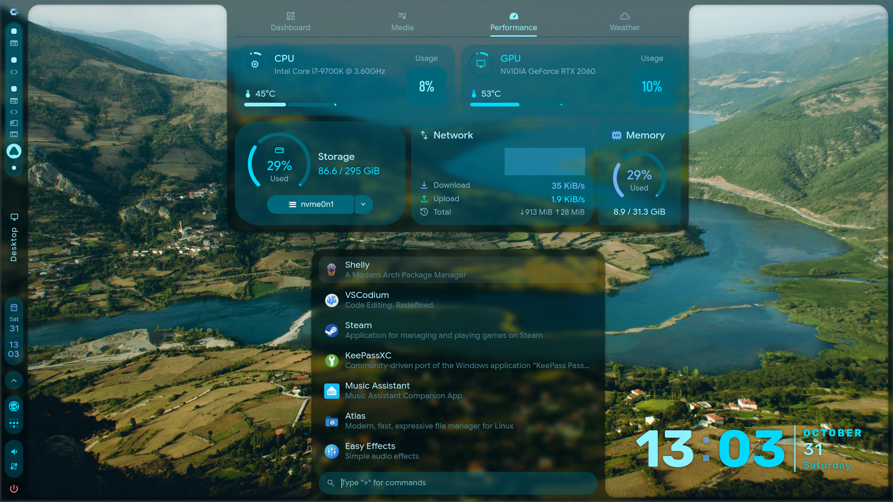

# Moddroid dot-files & Scripts

## Stack Base:
- CachyOS
- Hyprland 0.57+

## User Apps (not included):
- dux-shell
- plymouth-theme-hexagon-dots-git
- hyprmod
- lnxlink
- lnxlink-caelestia-modules
- Easyeffects
- Music Assistant AppImage
- Vesktop AppImage
- Keepassxc
- tailscaled
- sendspin
- syncthing
- lindiskinfo
- Butler Flatpack
- dux-files-bin
- dux-calendar-bin

## Scripts:
- dpms-guard (DP Monitor unplug hotifx)
- fix-ntfs (Fix nvme corruption on bad unmount)
- reload-shell (reloads shell with SUPER+ALT+F12)

## Service Overrides:
- lnxlink.service (delay lnxlink to allow hyprland startup)
- greetd (hide logs between plymouth and login)
- plymouth (allow full boot splash animation)

## Presets:
- Easyeffects Presets

## Extras:
- Wallpapers Folder
