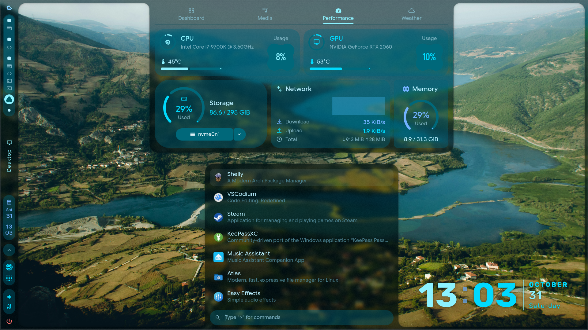
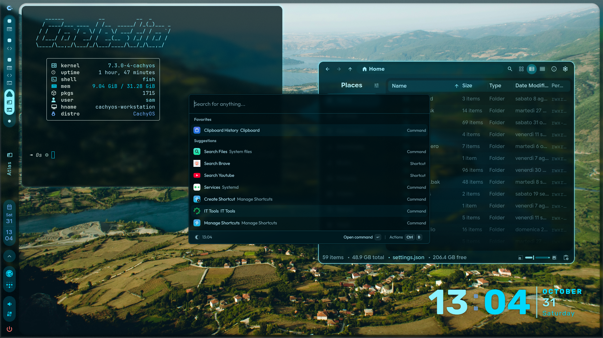

# Moddroid dot-files & Scripts

## Stack Base:
- CachyOS
- Hyprland 0.57+

## User Apps (not included):
- plymouth-theme-cross-hud-git
- hyprmod
- caelestia-dots
- caelestia-greeter
- caelestia-syncthing
- caelestia-tailscale
- lnxlink
- lnxlink-caelestia-modules
- Easyeffects AppImage
- Music Assistant AppImage
- Vesktop AppImage
- Keepassxc
- tailscaled
- sendspin
- syncthing
- localsend
- lindiskinfo
- Butler Flatpack
- hypr-lens
- satty
- vicinae-bin
- dfiles
- dcal
- awww
- vdirsyncer

## Scripts:
- dpms-guard (DP Monitor unplug hotifx)
- fix-ntfs (Fix nvme corruption on bad unmount)
- reload-caelestia (reloads caelestia shell with SUPER+ALT+F12)
- caelestia-vicinae-theme (custom vicinae theme matching with caelestia dynamic theme)

## Service Overrides:
- lnxlink.service (delay lnxlink to allow hyprland startup)
- greetd (hide logs between plymouth and login)
- plymouth (allow full boot splash animation)

## Presets:
- Easyeffects Presets

## Extras:
- Wallpapers Folder

# Setup Info:

- Custom greetd + caelestia-greeter login 
- Autostart Music & Home App on custom workspaces
- Autostart background apps
- Autostart fix scripts services & daemons
- custom plymouth animation and timers

# Addition over stock cachyOS/caelestia:

- vicinae Spotlight search
- Custom Screenshot grab + OCR via hypr-lens
- Satty screenshot editor
- Atlas file manager
- awww wallpaper changer
- custom SUPER + ALT + F12 caelestia reload
- custom decoration.lua (applying to shell wasn't working)
- custom lnxlink modules for hyprland
- custom calendar module with events highlights from ics events

# Other Screenshots:
